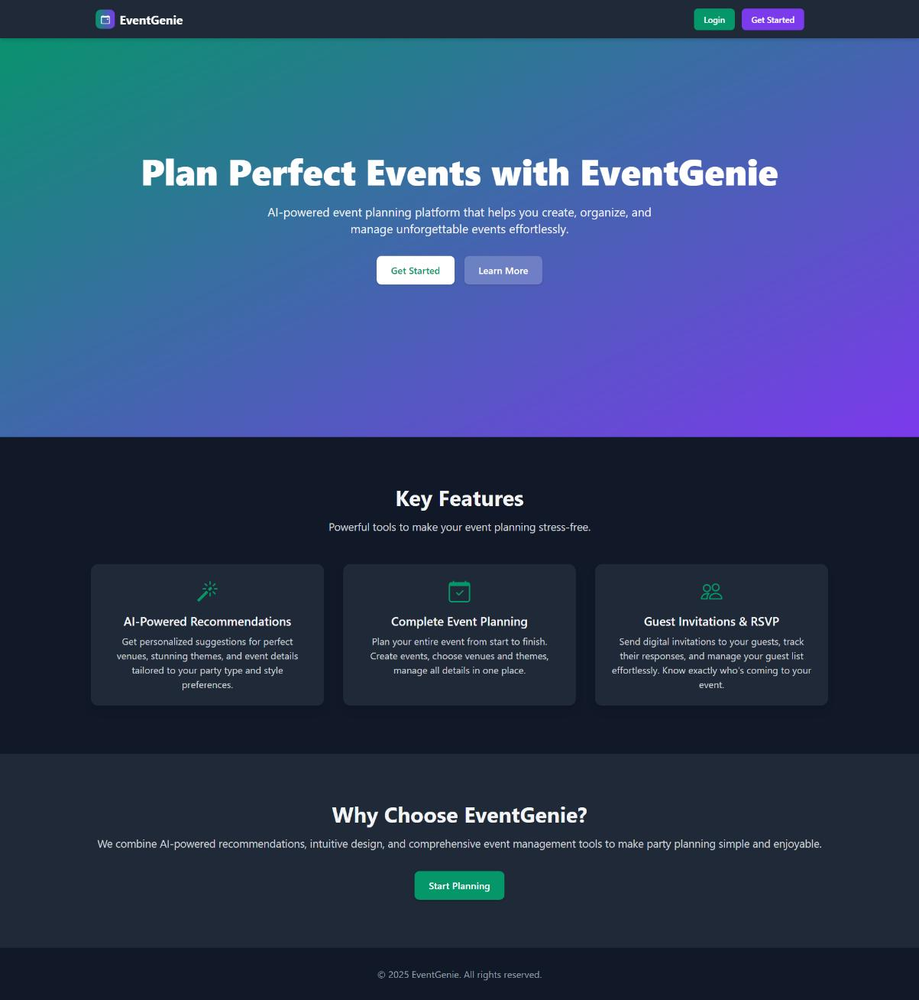
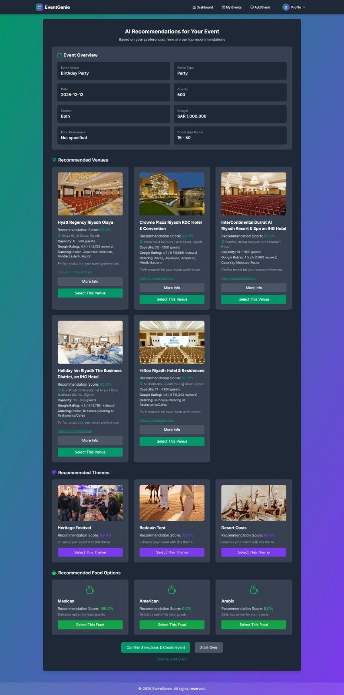
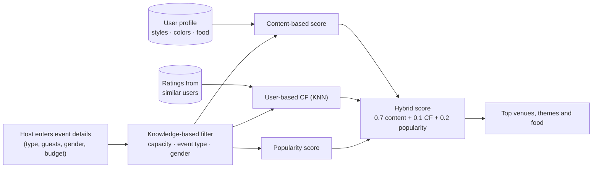
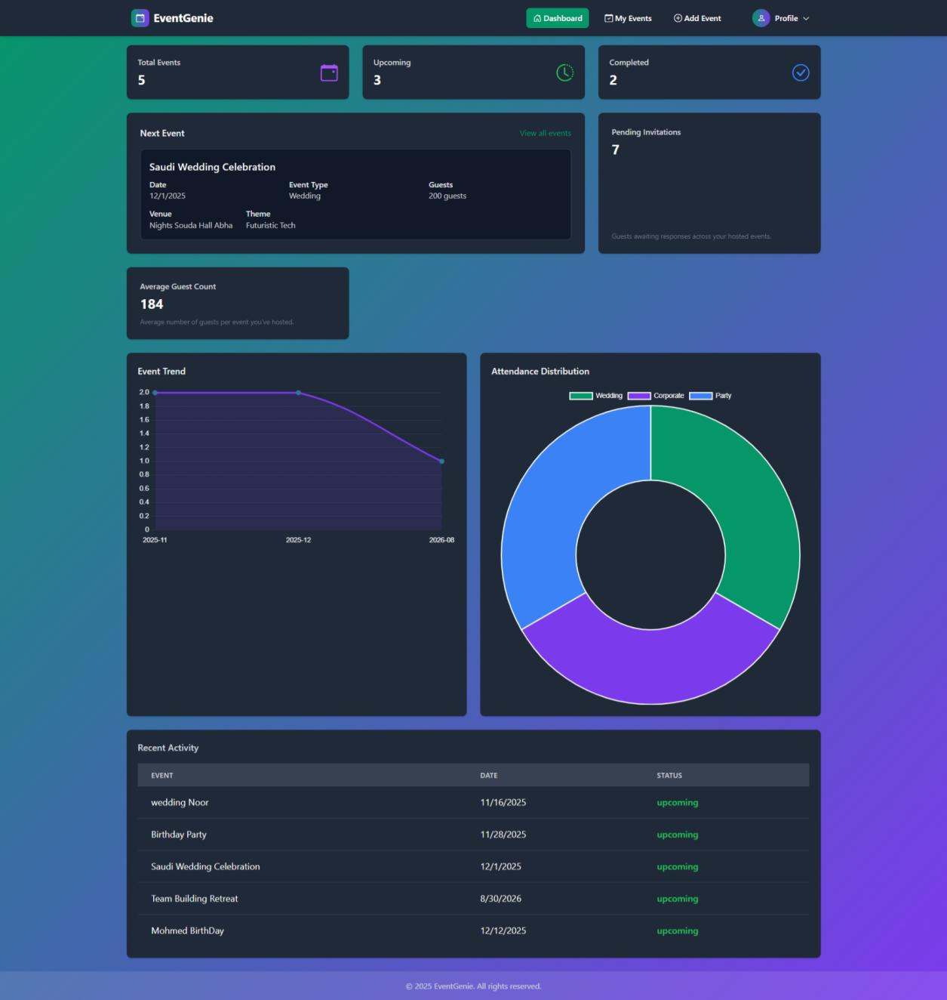
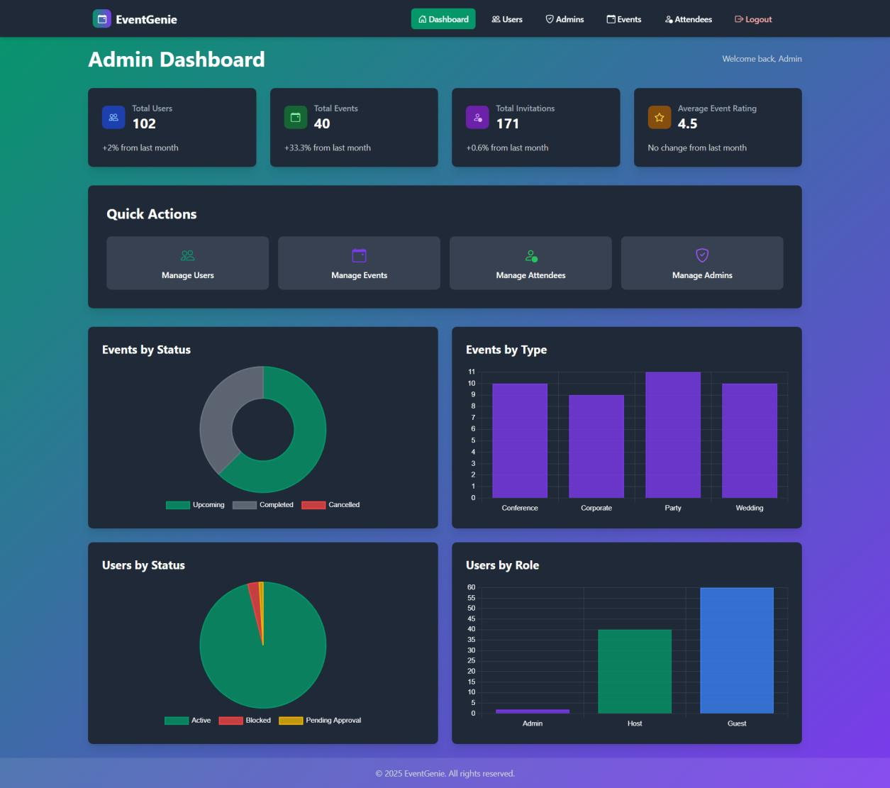
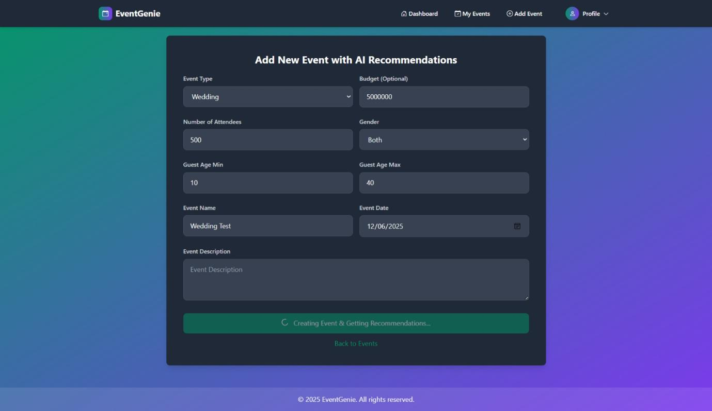
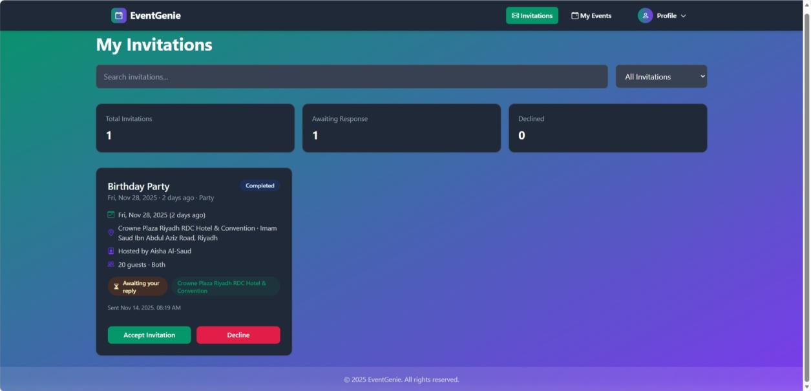

# EventGenie: Smart Event Planning with Personalized Recommendations


**Tell EventGenie what you're planning. Get ranked venues, themes and food that fit your event, your guests and your taste.**



<details>
<summary><b>🇸🇦 نبذة بالعربية</b></summary>

**EventGenie** منصة ويب لتخطيط المناسبات الخاصة (أعراس، حفلات، تخرج...) تقترح على المضيف **القاعة** و**الثيم** و**الأكل** المناسب لمناسبته باستخدام نظام توصيات هجين: فلترة حسب الشروط (السعة، نوع المناسبة، الفصل بين الرجال والنساء)، ومطابقة حسب المحتوى وتفضيلات المستخدم، وتصفية تعاونية (KNN) من تقييمات مستخدمين مشابهين. المنصة فيها ثلاثة أدوار: مدير، ومضيف، وضيف، مع إدارة الفعاليات والدعوات والتقييمات.

مشروع تخرج، قسم نظم المعلومات، جامعة الملك خالد.

</details>

---

## Why

A survey of **159 people** run for this project showed what makes event planning hard:

| Pain point | Respondents |
|---|---:|
| Staying within budget | 59.7% |
| Coordinating with vendors and services | 58.5% |
| Choosing and checking venues | 42.1% |

The most wanted feature was **venue suggestions based on event type (69.2%)**. EventGenie puts venue, theme and food choices into one guided flow instead of hours of manual research.

## What it does

| | |
|---|---|
| 🏛 **Venue recommendations** | Ranked by fit to event type, guest count, gender setup, food preference and ratings |
| 🎨 **Theme recommendations** | Matched to event type, cultural fit, the host's style and color preferences, and season |
| 🍽 **Food recommendations** | Matched to event type, the host's taste and popularity |
| 📅 **Event management** | Hosts create, edit and cancel events, then pick from the recommendations to finish setup |
| ✉️ **Invitations and RSVP** | Guests accept or decline invitations and leave feedback after the event |
| 📊 **Dashboards** | Separate admin, host and guest views with live statistics |



## 🧠 How the recommender works



1. **Filter.** Remove venues that cannot host the event: too small, wrong event type, or wrong gender setup.
2. **Score by content.** Match each remaining venue, theme and food option to the event and to the host's saved preferences.
3. **Score by similar users.** KNN finds hosts with similar preferences and boosts the items they rated highly.
4. **Combine.** A weighted hybrid score ranks the results. When there is no rating history yet (cold start), the collaborative weight drops to zero and content and popularity carry the ranking.

Ranking quality is measured with **Precision@K, Recall@K, MAP and NDCG@K**, plus diversity, coverage and popularity bias (`ai_recommendation/evaluation.py`).

## Architecture

| Layer | Technology |
|---|---|
| Frontend | HTML5, JavaScript, Tailwind CSS |
| Backend | PHP REST API (`backend/api.php`) |
| Recommendation service | Python, Flask, pandas, scikit-learn |
| Database | MySQL |
| Local server | XAMPP (Apache + MySQL) + Flask on port 5000 |

<table>
<tr>
<td></td>
<td></td>
</tr>
<tr>
<td align="center">Host dashboard</td>
<td align="center">Admin dashboard</td>
</tr>
<tr>
<td></td>
<td></td>
</tr>
<tr>
<td align="center">Create an event</td>
<td align="center">Guest invitations</td>
</tr>
</table>

## 🗂 Data

The database ships with **synthetic demo data** so the system can be run and evaluated end to end:

| Table | Rows |
|---|---:|
| Users (admin, hosts, guests) | 103 |
| Venues (Saudi venues with capacity, catering and ratings) | 37 |
| Event themes | 14 |
| Events | 44 |
| Invitations | 171 |
| Feedback ratings | 1,027 |

All names, emails and phone numbers are fictional.

## 🚀 Quick start

**Requirements:** XAMPP (or Apache + PHP + MySQL) and Python 3.9+.

1. Copy the project folder into XAMPP's `htdocs` folder and start **Apache** and **MySQL**.
2. In phpMyAdmin, create a database named `eventgenie_mvp` and import `database/eventgenie_mvp.sql`.
3. Check the database settings in `backend/config.php` and `ai_recommendation/config.py` (default: user `root`, empty password).
4. Start the recommendation service:
   ```bash
   cd ai_recommendation
   pip install -r requirements.txt
   python app.py   # runs on http://localhost:5000
   ```
5. Open `http://localhost/EventGenie/frontend/public/index.html`.

**Demo logins** (seed data, local use only):

| Role | Email | Password |
|---|---|---|
| Admin | `admin@eventgenie.com` | `Admin!2025$Secure` |
| Host | `omar.alghamdi5@eventgenie.com` | `password123` |
| Guest | `faisal.alqahtani3@eventgenie.com` | `password123` |

> **Email verification (optional):** sign-up can send a verification code by email. To turn it on, add your own SMTP details in `backend/config.php`. Never commit a real password or app password.

### API example

```bash
curl -X POST http://localhost:5000/recommend \
  -H "Content-Type: application/json" \
  -d '{"user_id": 2, "event_type": "Wedding", "guest_count": 100, "gender": "Both"}'

curl "http://localhost:5000/evaluate?k=3,5,10"   # MAP and NDCG@K
```

More endpoints are documented in [`ai_recommendation/README.md`](ai_recommendation/README.md).

## 📁 Repository structure

```
EventGenie/
├── ai_recommendation/     # Flask service: hybrid recommender + evaluation (MAP, NDCG@K)
├── backend/               # PHP REST API, auth, events, invitations, feedback
├── database/              # MySQL schema + synthetic seed data
├── frontend/
│   ├── public/            # admin, host and guest pages
│   ├── shared/            # navbar
│   └── assets/            # JS, Tailwind config, venue images
└── docs/images/           # screenshots
```

## ⚠️ Limitations

- Ratings and users are synthetic, so evaluation scores show the pipeline works, not real-world accuracy.
- Runs locally (XAMPP + Flask); it is not deployed.
- Recommendation weights are hand-set, not learned.

## 🗺 Roadmap

- [ ] Collect real user feedback and re-evaluate on it
- [ ] Learn the hybrid weights from data
- [ ] Cloud deployment (AWS, Azure or Google Cloud)
- [ ] Real-time vendor availability and booking
- [ ] Mobile app

## 👥 Team

Graduation project, **B.Sc. in Information Systems**, College of Computer Science, **King Khalid University** (2025–2026).

| Name |
|---|
| Ghadi Albishri ([@ghadialbishri](https://github.com/ghadialbishri)) |
| Ahlam Dafer |
| Bushra Abdullatif |

Supervised by **Dr. Asma Aldrees**.
